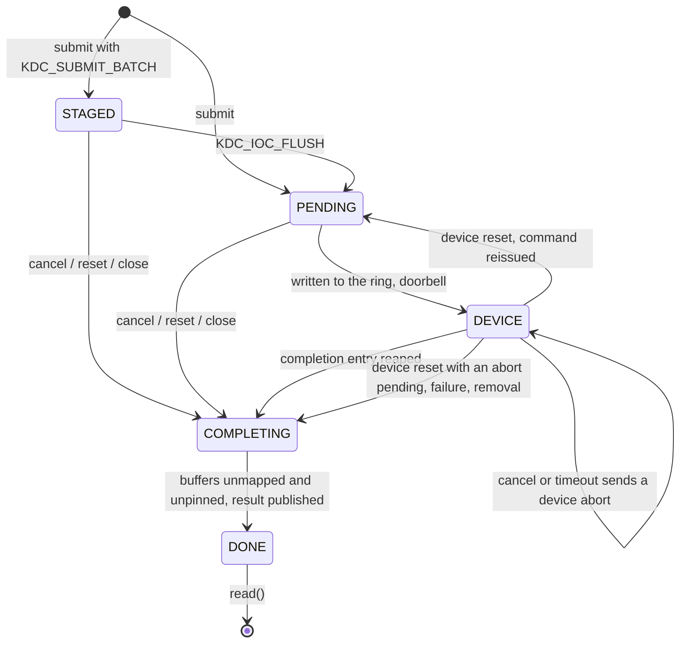

# Driver: buffer ownership, recovery, locking and lifetime

The driver (`kernel/`) creates `/dev/kdcN` per device. Each open file has its own
request ids, epoch, quota (64 unread commands, 4 MiB of src + dst bytes) and
completion list. The ABI is in `include/kdc_abi.h` (version 3).

## Command states

| State | Who owns the buffers | Cancel |
|---|---|---|
| STAGED, PENDING | driver; pinned and mapped, invisible to the device | released at once, completion `-ECANCELED`, returns 0 |
| DEVICE | device | writes the queue's ABORT register, returns `-EINPROGRESS`; buffers stay pinned and mapped until the device posts a completion or is stopped |
| COMPLETING | being released | `-EINPROGRESS` |
| DONE | nobody (no DMA resources left) | 0 if it was cancelled, `-EALREADY` otherwise |

**The release rule.** A command's buffers are unmapped and unpinned only when
the device can no longer DMA into them:

1. the device posted its completion (success, error, or an acknowledged abort);
2. the controller acknowledged a disable (READY cleared), which the device
   defines as "all DMA stopped";
3. a function-level reset completed;
4. bus mastering was turned off.

Nothing else releases a device-owned command: not a timeout, not cancel, not
close, not an expired abort.

`KDC_IOC_RESET` releases driver-owned commands with `-ECONNRESET`, aborts
device-owned ones, waits until all have ended, then advances the epoch; submits
during a reset get `EBUSY`, submits with the old epoch `ESTALE`. `close()` does
the same and frees everything afterwards. Both waits are bounded by the
recovery below.

## Timeouts and recovery (`kdc_recover.c`)

Each command has a timeout (`kdc_submit.timeout_ms`, default `cmd_timeout_ms`
= 5000), counted from the doorbell. A watchdog runs every 100 ms while the
device owns commands:

- a command past its deadline gets a device abort; if the device honours it,
  the command completes with `-ETIMEDOUT` and nothing else happens;
- an abort (from a timeout, cancel, reset or close) unanswered after
  `abort_timeout_ms` (500), a fatal device, a halted queue, or a status register
  reading all-ones starts recovery.

Recovery, under `reset_lock`:

1. Stop dispatching on all queues. If the status register reads all-ones and
   the function is gone from config space, the device is treated as removed:
   step 4 with `-ENODEV`, no reset attempted.
2. Controller reset: write CTRL = 0 and wait up to `reset_timeout_ms` (1000) for
   READY to clear. Then reap any completions the device posted, reissue
   in-flight commands that nobody asked to abort (at most twice per command
   for resets the driver starts itself; resets from sysfs do not count),
   end the others with their abort reason (`-ETIMEDOUT`, `-ECANCELED`,
   `-ECONNRESET`), re-initialise the rings and vector registers, re-enable, and
   dispatch again.
3. If the controller did not stop or does not come back:
   `pci_try_reset_function()` performs an FLR, which calls `reset_prepare`
   (stop dispatching) and `reset_done` (check that the device has stopped, then
   the same take-back and restart as step 2). A reset written to
   `/sys/bus/pci/devices/<bdf>/reset` takes exactly this path.
4. If that fails too: clear bus mastering, end every command (`-EIO`, or the
   abort reason), and mark the device failed. Submits get `-EIO`; reads still
   return completions. A later successful reset (for example from sysfs) makes
   the device usable again.

Completion flags tell the caller what happened: `KDC_COMPL_ABORTED` (the
device acknowledged an abort), `KDC_COMPL_RESET` (ended by a reset, failure or
removal rather than by the device).

## Removal

`remove()` stops the watchdog and the recovery work, deletes the char device,
marks the device dead under `gone_lock` (ioctls hold it shared), disables the
controller unless the device is already failed or gone, clears bus mastering,
frees the IRQs, then ends every staged, pending and device-owned command with
`-ENODEV` (or its abort reason) and wakes every reader. Open files keep the
`kdc_dev` structure alive through the class device's refcount; afterwards
their ioctls return `ENODEV`, `read()` returns the remaining completions and
then `ENODEV`, and `poll()` reports `POLLHUP`.

A device that stops responding before it is removed (surprise removal: BAR
reads all-ones, no interrupts) is noticed by the watchdog within one tick
while it owns commands; all commands end with `-ENODEV` immediately, without
waiting for their timeouts, and the later `remove()` skips hardware access.

Recovery may be waiting in `pci_try_reset_function()` while `remove()` holds
the device lock; the try variant fails instead of blocking, so `remove()`'s
wait for the recovery work is bounded.

## Data path

- Zero-copy (default above `bounce_max`: 2048 bytes with direct DMA, 65536
  behind a translating IOMMU, see design-tradeoffs): `pin_user_pages_fast`
  (source read-only, destination `FOLL_WRITE`), `sg_alloc_table_from_pages_segment`,
  `dma_map_sgtable`, and the mapped segments written into an SG list block from
  a coherent DMA pool. Only the whole cache lines inside the destination are
  mapped for device writes; the partial first and last lines (under 64 bytes
  each) are written by the device into the SG block and copied into place
  after a successful completion.
- Bounce (at or below `bounce_max`): the source is copied into a pooled coherent
  buffer at submit; the device writes the second half of that buffer; on
  completion the driver copies it into the pinned destination pages.
- **Destination overlap.** Before anything is mapped, the destination's
  physical byte ranges go into a module-wide interval tree. A submit whose
  destination shares a byte with the destination of any in-flight command (any
  file, any kdc device, any virtual mapping of the same memory) fails with
  `EADDRINUSE`; it succeeds again once the other command has completed.
  Destinations that share only a cache line are allowed: the partial lines are
  bounced, so no two streaming device-writable mappings ever share a line, and
  the CPU never copies into a line under someone else's mapping.

## Queues and interrupts

- One MSI-X vector per queue plus one for errors, from
  `pci_alloc_irq_vectors_affinity(..., PCI_IRQ_MSIX | PCI_IRQ_AFFINITY)` with
  the error vector excluded from spreading. The CPU-to-queue map is built from
  each vector's affinity mask; `KDC_QUEUE_AUTO` uses the submitting CPU's queue.
- Completion handling is a threaded IRQ: the hard handler only wakes the thread,
  because `unpin_user_pages_dirty_lock()` may sleep. The thread reaps entries by
  phase bit under the queue lock, rings the CQ_HEAD doorbell, dispatches pending
  commands into the freed ring space, then releases and publishes outside the lock.
- Interrupt coalescing is off by default (one interrupt per completion); the
  `coalesce_count`/`coalesce_usecs` parameters and the debugfs `coalesce` file
  set the device's per-queue count and delay, and resets keep the setting.
  The KVM measurements behind that default are in design-tradeoffs.
- The error vector's handler acknowledges the error and schedules recovery for
  FATAL and RING_DMA.
- A completion whose cid does not match the command holding that tag is counted
  and ignored; the command it should have completed later times out.

## Locks

Order: `reset_lock` -> `files_mutex` -> `ctx->lock` -> `queue->lock`.
`queue->lock` covers the rings, slot table, pending list and the phase of
PENDING/DEVICE commands; `ctx->lock` covers the file's lists and counters.
`reset_lock` serialises recovery, `reset_prepare`..`reset_done` and `remove()`'s
teardown. The abort register is written under `queue->lock` after checking that
the slot still holds this command: a tag is only reissued after its completion
was reaped under the same lock, so an abort cannot hit the tag's next owner.
`close()` returns commands to the DMA pools while holding `files_mutex`, which
keeps `remove()` from destroying the pools underneath it.

## Debugfs and module parameters

- `/sys/kernel/debug/kdc/kdcN/`: the device's fault and timing registers
  (`service_ns`, `fault`, `fault_drop`, `fault_bad_cid`, `fault_bad_dma`), its
  counters (`device_aborted`, `device_doorbells`, `device_cq_doorbells`,
  `device_irqs`), `device_inflight` (commands the device itself holds, read
  from the queues' INFLIGHT registers), `scratch`, and `coalesce`, the
  interrupt coalescing of every queue as `usecs << 16 | count` (kept across
  resets). Tests use them to hold commands inside the device on purpose; the
  benchmark uses `scratch` and `coalesce`.
- `/sys/kernel/debug/kdc/`: module-wide `cmds`, `pinned_pages`, `mapped_sgts`
  and `dst_ranges`, which must return to zero once every file is closed, also
  across device removal.
- Parameters (`/sys/module/kdc/parameters/`): `cmd_timeout_ms` (5000),
  `abort_timeout_ms` (500), `reset_timeout_ms` (1000), `bounce_max` (-1: 2048 or
  65536 as above; read at probe, at most 65536), `queue_depth` (64), `max_queues` (16),
  `coalesce_count` and `coalesce_usecs` (0 and 0: one interrupt per completion;
  read at probe), and
  `track_overlap` (on; boot-time only). Turning `track_overlap` off breaks the
  destination rule above; it exists so that the tracker's cost can be measured
  (`results/round3/perf/tracker/`).
